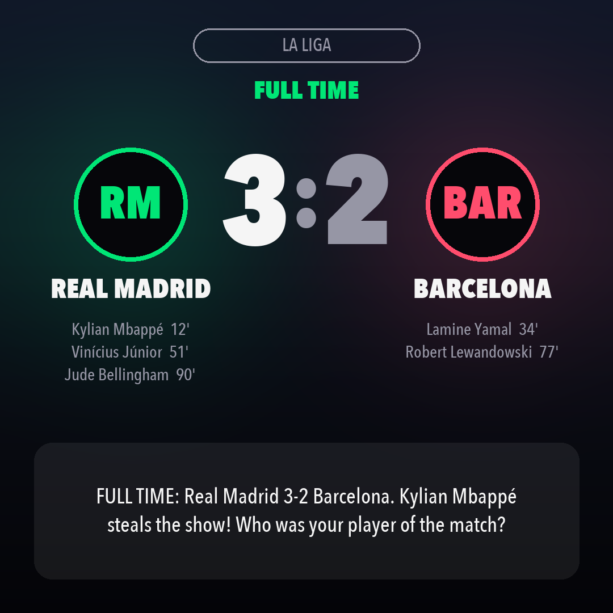

# ⚽ Matchday AI

**An AI caption pipeline for football matches that checks its own work.**

Matchday AI takes football results, writes social media captions for Instagram, TikTok and X, and checks every caption for mistakes before it is accepted. If a caption fails a check, the writer gets feedback and tries again. Every attempt is saved in a database. Each match also gets a ready-to-post image card.

> A personal learning project by **Fatemeh Yousefi**.

<p align="center">
  
</p>

---

## The project in two ways

**🟢 In simple words**

Imagine you work for a football page on Instagram. After every match, someone has to write a short post: *"FULL TIME: Ajax 2-1 PSV!"*. An AI can write these posts very fast, but sometimes it makes mistakes, like writing the score the wrong way around.

So this project works like a team of two:
- a **writer**, who writes the post, and
- a **checker**, who reads it and says *"this is wrong, please fix it"*.

The writer tries again until the checker is happy (at most 3 times). Then the project makes a nice picture for the post and keeps a notebook (a database) of every try.

**🔵 Technically**

A Python pipeline that reads match data from JSON, validates it with Pydantic, and generates a structured caption (`caption` + `hashtags`) for each match × platform. Six check functions return `CheckResult` objects. If any check fails, the failure details go back to the writer as feedback (up to `MAX_ATTEMPTS = 3`). Every attempt and every check result goes into two SQLite tables, and a SQL report prints the first-try pass rate per platform. Approved Instagram captions are rendered into 1080×1080 PNG cards with Pillow.

## Why I built this

AI models write fluent text, but they can also get facts wrong: a swapped score, a player who never scored, or too many hashtags. On a sports account with millions of fans, one wrong score is a public mistake.

I built this project to learn how to use AI-generated text safely in practice. The model writes the captions, plain Python code checks them, and nothing is published until every check passes.

## What I learned

| Topic | What I practised |
|---|---|
| **Data modelling** | Describing matches, goals and captions with **Pydantic** models, so bad data is rejected straight away (for example, a goal in minute 200) |
| **Prompt design** | Writing a system prompt with a brand voice and hard rules, and building the user prompt from real match data |
| **Structured output** | Making the writer return a fixed shape (`caption` + `hashtags`) instead of free text |
| **Guardrails** | Writing small, testable checks that catch wrong facts and broken rules |
| **Feedback loops** | Sending failed checks back to the writer so it can fix its own mistakes (up to 3 attempts) |
| **Testing** | Unit tests for every check with **pytest** |
| **Databases & SQL** | Saving every attempt and check result in **SQLite**, then reporting pass rates with SQL |
| **Image generation** | Drawing match cards with **Pillow**: gradients, glows, team badges and text layout |

## How I built it, step by step

I built the project in small steps and committed each one to git. Each step adds one idea on top of the one before.

### Stage 1: Describe the data
| # | Step | 🟢 In simple words | 🔵 Technically |
|---|---|---|---|
| 1 | Match and Goal models + sample data | I told Python what a football match looks like | Pydantic `Match` and `Goal` models with validation (`minute` between 1 and 130, scores ≥ 0), plus `data/matches.json` |
| 2 | Improve the models | Added handy shortcuts, like "the score as text" | `scoreline` and `scorers` properties on `Match` |
| 3 | Platform class | Each app (Instagram, TikTok, X) has its own rules | A frozen `Platform` dataclass with `max_chars`, `max_hashtags` and `style`, stored in a `PLATFORMS` dict |

### Stage 2: The writer
| # | Step | 🟢 In simple words | 🔵 Technically |
|---|---|---|---|
| 4 | System prompt | I wrote the "job description" for the AI: tone and strict rules | `SYSTEM_PROMPT` in `writers.py` with the brand voice and hard factual rules |
| 5 | User prompt | Each request gives the AI the match facts and the platform rules | `build_user_prompt()` puts the platform style, limits and match JSON together, and adds feedback when there is any |
| 6–7 | Fake AI (MockWriter) | A pretend AI, so I can test for free without the internet | `MockWriter.write()` returns a `CaptionDraft`. It makes mistakes on purpose on the first try |

### Stage 3: The checker
| # | Step | 🟢 In simple words | 🔵 Technically |
|---|---|---|---|
| 8 | Score, team and player checks | The checker makes sure the facts are right | `check_score`, `check_teams`, `check_players` each return a `CheckResult` |
| 9 | All quality checks | Also checks length, hashtags and polite language | `check_length`, `check_hashtags`, `check_safe_language` (regex + banned word set), combined in `run_all_checks()` |

### Stage 4: Tests
| # | Step | 🟢 In simple words | 🔵 Technically |
|---|---|---|---|
| 10 | First tests | Automatic proof that the checker catches mistakes | pytest unit tests: a correct score passes, a swapped score fails |
| 11 | A test for every check | Every rule now has its own test | 8 tests in `tests/test_checks.py`; `pythonpath = ["src"]` in `pyproject.toml` |

### Stage 5: The pipeline
| # | Step | 🟢 In simple words | 🔵 Technically |
|---|---|---|---|
| 12 | Load all matches | The program reads all the matches from the file | `load_matches()` with `Match.model_validate()` for each item |
| 13 | Feedback loop | If the checker says "wrong", the writer tries again with tips | `caption_with_retries()`: failed check details go back as `feedback`, up to `MAX_ATTEMPTS = 3` |

### Stage 6: Remember everything
| # | Step | 🟢 In simple words | 🔵 Technically |
|---|---|---|---|
| 14 | Save every attempt | The program writes every try in a notebook | `db.save_caption()` is called on every attempt |
| 15 | SQLite + SQL report | The notebook is a real database, and I ask it questions | Tables `captions` and `checks`. `GROUP BY` queries for the first-try pass rate and the most failed checks |

### Stage 7: Pictures
| # | Step | 🟢 In simple words | 🔵 Technically |
|---|---|---|---|
| 16 | First match card | The program draws a picture with the score | Pillow `Image` + `ImageDraw`, a 1080×1080 PNG |
| 17 | Caption on the card | The approved post text goes on the picture too | Text wrapping, emoji removal, and rendering inside the pipeline for passing Instagram captions |
| 18 | Nicer design + README | Made the pictures beautiful and wrote this page | Gradient background, blurred glows, team badges, dimmed losing score, see-through caption panel |

## How it works

```
 data/matches.json
        │
        ▼
 ┌──────────────┐    prompt + feedback    ┌──────────────┐
 │   Pipeline   │ ──────────────────────▶ │    Writer    │
 │              │ ◀────────────────────── │  (mock LLM)  │
 └──────┬───────┘     caption draft       └──────────────┘
        │
        ▼
 ┌──────────────┐   failed? → feedback → try again (max 3)
 │    Checks    │
 └──────┬───────┘
        │ every attempt
        ▼
 ┌──────────────┐        ┌──────────────────────┐
 │    SQLite    │        │  Pillow match card    │
 │  matchday.db │        │  output/<match>.png   │
 └──────────────┘        └──────────────────────┘
```

1. **Load** the matches from `data/matches.json` and validate them with Pydantic.
2. **Write** a caption for each match and each platform (Instagram, TikTok, X). Each platform has its own style and limits.
3. **Check** the caption with six rules (see below).
4. **Retry** with feedback if any check fails, for example: *"Score must appear as 2-1 (home-away)"*.
5. **Save** every attempt and every check result in SQLite.
6. **Render** a match card image for each approved Instagram caption.
7. **Report** the first-try pass rate per platform and the most common failures.

### The six checks

| Check | What it catches |
|---|---|
| `score_correct` | The score is missing or swapped (`1-2` instead of `2-1`) |
| `teams_mentioned` | One of the team names is missing |
| `only_real_scorers` | A player is mentioned who did not score in this match |
| `length_ok` | The caption is too long for the platform |
| `hashtags_ok` | Too many (or zero) hashtags |
| `safe_language` | Insulting words that don't fit the brand voice |

### About the mock writer

The pipeline uses `MockWriter`, a fake LLM. It is free, works offline and gives the same answer every time. It also **makes mistakes on purpose** on the first try (a swapped score, too many hashtags), so you can watch the feedback loop fix them. The prompts in `writers.py` are written for a real model, so a real LLM can replace it later.

## Example output

```
  feedback: ['score_correct: Score must appear as 2-1 (home-away)']
[PASS] m001 instagram (attempts: 2) FULL TIME: Ajax 2-1 PSV. Brian Brobbey steals the show! Who was your player of the match? 👇
...

=== First-try pass rate ===
instagram  3/5 = 60%
tiktok     0/5 = 0%
x          3/5 = 60%

=== Failed checks ===
score_correct   6
hashtags_ok     5
```

## How to run the project

You only need **Python 3.10 or newer**. No API key and no internet are needed, because the writer is a mock. All commands go in a terminal (on Mac: the *Terminal* app).

### Step 0: Check that Python is installed

```bash
python3 --version
```

🟢 This prints something like `Python 3.14.0`. If you see an error, install Python from [python.org](https://www.python.org/downloads/) first.

### Step 1: Download the project and go into its folder

```bash
git clone <this-repository-url>
cd matchday-ai
```

🟢 This copies the project to your computer and moves you inside it. All the next commands must run from this folder.

### Step 2: Create a virtual environment (one time only)

```bash
python3 -m venv .venv
```

🟢 A *virtual environment* is a private box for this project's packages, so they don't mix with other projects on your computer.
🔵 This creates a `.venv/` folder with its own Python interpreter and `site-packages`. It is in `.gitignore`, so it is never committed.

### Step 3: Turn the virtual environment on (every time you open a new terminal)

```bash
source .venv/bin/activate
```

🟢 Your terminal line now starts with `(.venv)`. That means it's on. To turn it off later, type `deactivate`.
🔵 `activate` puts `.venv/bin` first on your `PATH`, so `python`, `pip` and `pytest` use the project's environment.

### Step 4: Install the packages (one time only)

```bash
pip install pydantic pillow pytest
```

🟢 This downloads the three tools the project uses.
🔵 `pydantic` handles data models and validation, `pillow` draws the images, and `pytest` runs the tests.

### Step 5: Run the pipeline

```bash
PYTHONPATH=src python -m matchday
```

🟢 This starts the project. You'll see the writer make mistakes, get feedback and fix them, and a small report appears at the end.
🔵 The code lives in `src/matchday/`, so `PYTHONPATH=src` tells Python where to find the `matchday` package. `-m matchday` runs `src/matchday/__main__.py`, which calls `run_pipeline()`.

### Step 6: Look at the results

Everything is saved in the `output/` folder:

| File | What it is |
|---|---|
| `output/m001.png` … `m005.png` | 🟢 The match pictures, one per match. Open them like any photo: `open output/m003.png` (Mac) |
| `output/matchday.db` | 🟢 The "notebook" with every try. 🔵 A SQLite database with the tables `captions` and `checks` |

🔵 To look inside the database with SQL:

```bash
sqlite3 output/matchday.db "SELECT match_id, platform, attempt, passed, caption FROM captions;"
```

> Every run starts fresh: the old database is deleted and the images are overwritten.

### Step 7: Run the tests

```bash
pytest
```

🟢 This automatically checks that the checker works correctly. You should see `8 passed`.
🔵 pytest finds `tests/test_checks.py` (configured in `pyproject.toml`) and runs one or more unit tests per check function.

### Try it yourself ✏️

- **Add your own match:** add a new entry to `data/matches.json` (copy an existing one and change the teams, score and goals), then run Step 5 again.
- **Change the card colours:** edit `HOME`, `AWAY`, `TOP` and `BOTTOM` at the top of `src/matchday/graphics.py`.
- **Break a rule on purpose:** add a word like `"trash"` to the caption in `writers.py` and watch `safe_language` fail.

### Problems?

| You see | Fix |
|---|---|
| `No module named matchday` | You forgot `PYTHONPATH=src`, or you are not in the project folder |
| `No module named pydantic` / `PIL` / `pytest` | The virtual environment is off: run Step 3, then Step 4 |
| `command not found: python` | Use `python3`, or turn on the virtual environment first |
| The card font looks plain | The cards use *Avenir Next Condensed*, which comes with macOS. On Windows or Linux, Pillow's default font is used instead |

## Project structure

```
matchday-ai/
├── data/
│   └── matches.json        # sample match results
├── src/matchday/
│   ├── __main__.py         # entry point: python -m matchday
│   ├── models.py           # Pydantic models: Match, Goal, CaptionDraft, Platform
│   ├── writers.py          # system prompt, user prompt and the MockWriter
│   ├── checks.py           # the six quality checks
│   ├── pipeline.py         # load → write → check → retry → save → render
│   ├── db.py               # SQLite tables and the SQL report
│   └── graphics.py         # match card image with Pillow
└── tests/
    └── test_checks.py      # pytest tests for every check
```

## Next steps

- [ ] Replace `MockWriter` with a real LLM (for example the Claude API) using the same prompts
- [ ] Add real team colours and logos to the match cards
- [ ] Add a `requirements.txt` or `pyproject.toml` dependencies
- [ ] Compare first-try pass rates across different prompts

---

<p align="center">Made with ⚽ and Python by <b>Fatemeh Yousefi</b></p>
